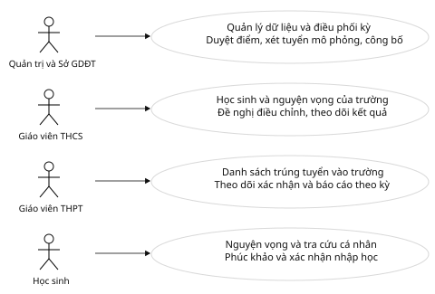
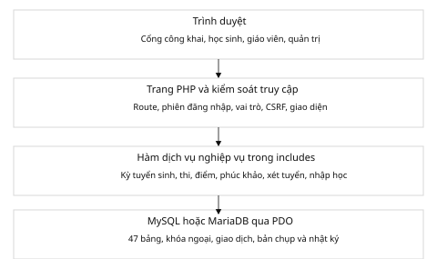
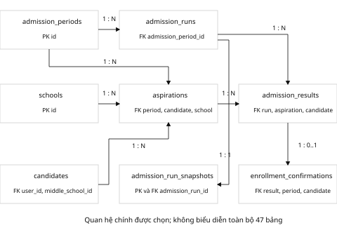
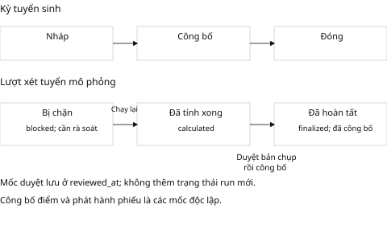
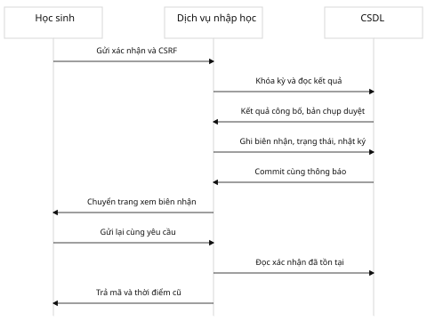

# Báo cáo phạm vi và hiện thực hệ thống tuyển sinh lớp 10 TP.HCM

Nhóm 4 · Bản chốt phục vụ đồ án · 22/10/2026

[Bản PDF đọc và in](report/bao_cao_pham_vi_hien_thuc_TPHCM.pdf)

## Kết luận và phiên bản

Hệ thống đã hiện thực một quy trình tuyển sinh lớp 10 thường THPT công lập tại TP.HCM phục vụ đồ án. Phiên bản được chốt để trình diễn và bàn giao mô phỏng; chưa được chứng nhận dùng để quyết định tuyển sinh chính thức.

Báo cáo này mô tả phạm vi hiện thực tại ngày 22/10/2026, đối chiếu mã nguồn, 38 use case gốc và bằng chứng kiểm tra gần nhất ngày 21/10/2026. Không dùng số lượng kiểm tra đạt để thay thế nghiệm thu quy chế, bảo mật hoặc khả năng phục vụ quy mô toàn thành phố.

Nguồn hiện tại có 47 bảng, 720 hồ sơ giả lập, 723 tài khoản, hai cán bộ giáo viên và bảy bản ghi trường học. Có một kỳ bản nháp; nguyện vọng, điểm, kết quả và xác nhận nhập học đang rỗng. Hai THCS có tên thật Nguyễn Du và Lê Quý Đôn; người và thông tin hồ sơ là dữ liệu mô phỏng.

Bản Word tuần 5 là biên bản họp và đặc tả ban đầu, không phải bằng chứng nghiệm thu phần mềm hôm nay. Bản gốc và các quyết định Batch J được giữ nguyên nội dung lịch sử. Báo cáo này bổ sung đối chiếu hiện thực, không ký hay xác nhận thay cơ quan tuyển sinh.

## Phạm vi chức năng và tác nhân

Trong phạm vi: tài khoản và phân quyền; danh mục trường, cán bộ, hồ sơ; đề nghị và duyệt điều chỉnh; cấu hình kỳ, thời hạn và chỉ tiêu; đăng ký nguyện vọng; tổ chức thi và phiếu dự thi; điểm, phúc khảo; xét tuyển mô phỏng, công bố; xác nhận nhập học; thống kê, nhật ký và công cụ sao lưu thử phục hồi.

Ngoài phạm vi đã chốt: chuyên, tích hợp, tuyển thẳng, xét tuyển đặc thù; thi trực tuyến, ngân hàng đề và soạn phát đề; thanh toán; SMS/email bên ngoài; kết nối cơ sở dữ liệu ngành hoặc dịch vụ định danh; tự chứng nhận quy tắc chính thức và vận hành Internet ở quy mô thành phố.

Các tên admin, so_gdtd, teacher, candidate là mã vai trò đang có. THCS và THPT của giáo viên được xác định từ liên kết staff.school_id và cấp trường; không giả định đã có hai vai trò CSDL độc lập teacher_thcs và teacher_thpt.

Học sinh sở hữu hồ sơ của mình. Giáo viên THCS xem học sinh trường mình; giáo viên THPT xem dữ liệu gắn với trường và kỳ tương ứng. Một giáo viên không mặc nhiên có quyền chấm hoặc phúc khảo; nhiệm vụ đó cần phân công và quyền phù hợp.

[Nguồn sơ đồ Mermaid](diagrams/usecase_overview.mmd)

### Đối chiếu 38 use case với mã nguồn

#### UC01 Quản lý phách
Cấp và ghép phách; khóa sau rà soát điểm. Đường dẫn: [exam/papers.php](../exam/papers.php). Bằng chứng kỹ thuật liên quan: Grading.

#### UC02 Nhập điểm
Nhập trực tiếp hoặc file; xem trước và kiểm tra lại khi lưu. Đường dẫn: [exam/grading.php](../exam/grading.php). Bằng chứng kỹ thuật liên quan: Grading.

#### UC03 Cập nhật kết quả phúc khảo
Theo phân công; giữ điểm gốc và lịch sử thay đổi. Đường dẫn: [appeals/update_result.php](../appeals/update_result.php). Bằng chứng kỹ thuật liên quan: D, Grading.

#### UC04 Phân công cán bộ coi thi
Hai giám thị; kiểm tra nhiệm vụ và trùng lịch. Đường dẫn: [exam/invigilators.php](../exam/invigilators.php). Bằng chứng kỹ thuật liên quan: Organization.

#### UC05 Thêm cán bộ giáo viên
Quản lý hồ sơ; có luồng nhập danh sách riêng. Đường dẫn: [staff/create.php](../staff/create.php). Bằng chứng kỹ thuật liên quan: I, School.

#### UC06 Sửa cán bộ giáo viên
Cập nhật hồ sơ và liên kết trường theo quyền. Đường dẫn: [staff/edit.php](../staff/edit.php). Bằng chứng kỹ thuật liên quan: I, School.

#### UC07 Xóa cán bộ giáo viên
Ngừng hoạt động; chặn khi còn phân công đang dùng. Đường dẫn: [staff/delete.php](../staff/delete.php). Bằng chứng kỹ thuật liên quan: I.

#### UC08 Thành lập hội đồng coi thi
Quản lý hội đồng, thành viên và điểm thi theo kỳ. Đường dẫn: [councils/create.php](../councils/create.php). Bằng chứng kỹ thuật liên quan: D.

#### UC09 Thành lập hội đồng chấm thi
Quản lý hội đồng và môn; hỗ trợ phân công chấm. Đường dẫn: [councils/create.php](../councils/create.php). Bằng chứng kỹ thuật liên quan: D, Grading.

#### UC10 Thành lập hội đồng phúc khảo
Quản lý thành viên; kiểm tra người xử lý được giao. Đường dẫn: [councils/create.php](../councils/create.php). Bằng chứng kỹ thuật liên quan: D, Grading.

#### UC11 Thành lập hội đồng ra đề
Chỉ quản lý tổ chức hội đồng; không soạn hay phát đề. Đường dẫn: [councils/create.php](../councils/create.php). Bằng chứng kỹ thuật liên quan: D.

#### UC12 Đăng xuất
Kết thúc phiên hiện tại; không phải đăng xuất mọi thiết bị. Đường dẫn: [auth/logout.php](../auth/logout.php). Bằng chứng kỹ thuật liên quan: H.

#### UC13 Duyệt điều chỉnh hồ sơ
So sánh trước sau; duyệt hoặc từ chối; giữ lịch sử. Đường dẫn: [adjustments/index.php](../adjustments/index.php). Bằng chứng kỹ thuật liên quan: School.

#### UC14 Gửi yêu cầu điều chỉnh
Giáo viên gửi đề nghị trong phạm vi trường mình. Đường dẫn: [teacher/adjustments.php](../teacher/adjustments.php). Bằng chứng kỹ thuật liên quan: School.

#### UC15 Đăng ký nguyện vọng
Một đến ba nguyện vọng; thứ tự, trùng trường và thời hạn. Đường dẫn: [aspirations/index.php](../aspirations/index.php). Bằng chứng kỹ thuật liên quan: School, Period.

#### UC16 Xem thẻ dự thi
Chính chủ xem phiếu sau khi tổ chức thi được phát hành. Đường dẫn: [exam/card.php](../exam/card.php). Bằng chứng kỹ thuật liên quan: Organization.

#### UC17 Thêm trường THCS THPT
Danh mục trường và thông tin liên hệ theo ngữ cảnh TP.HCM. Đường dẫn: [schools/create.php](../schools/create.php). Bằng chứng kỹ thuật liên quan: G1.

#### UC18 Cập nhật trường THCS THPT
Có cập nhật; đổi cấp trường còn thiếu quy trình chuyển dữ liệu. Đường dẫn: [schools/edit.php](../schools/edit.php). Bằng chứng kỹ thuật liên quan: G1; giới hạn DEC.

#### UC19 Xóa trường THCS THPT
Còn giới hạn: xóa vật lý và FK; chưa đủ luồng ngừng dùng/lịch sử. Đường dẫn: [schools/delete.php](../schools/delete.php). Bằng chứng kỹ thuật liên quan: G1; giới hạn DEC.

#### UC20 Đặt chỉ tiêu tuyển sinh
Chỉ tiêu theo trường và kỳ; phân biệt thiết lập và công bố. Đường dẫn: [quotas/index.php](../quotas/index.php). Bằng chứng kỹ thuật liên quan: Period.

#### UC21 Xét tuyển thí sinh
Chỉ mô phỏng; NV1 đến NV3, đồng điểm dừng để rà soát. Đường dẫn: [admission/calculate.php](../admission/calculate.php). Bằng chứng kỹ thuật liên quan: Selection.

#### UC22 Công bố điểm thi
Yêu cầu rà soát điểm; bảo vệ điểm gốc sau công bố. Đường dẫn: [publication/index.php](../publication/index.php). Bằng chứng kỹ thuật liên quan: Grading.

#### UC23 Công bố kết quả tuyển sinh
Chỉ lượt mới nhất đã duyệt và còn khớp dữ liệu. Đường dẫn: [publication/index.php](../publication/index.php). Bằng chứng kỹ thuật liên quan: Selection.

#### UC24 Xem điểm thi
Chính chủ xem điểm đã công bố và kết quả phúc khảo hiệu lực. Đường dẫn: [results/exam.php](../results/exam.php). Bằng chứng kỹ thuật liên quan: G2, Grading.

#### UC25 Xem kết quả xét tuyển
Ẩn lượt xem trước; đọc lượt hoàn tất đã công bố của đúng kỳ. Đường dẫn: [admission/results.php](../admission/results.php). Bằng chứng kỹ thuật liên quan: Selection.

#### UC26 Xác nhận nhập học
Theo kỳ và chính chủ; đúng hạn; gửi lặp trả biên nhận cũ. Đường dẫn: [enrollment/confirm.php](../enrollment/confirm.php). Bằng chứng kỹ thuật liên quan: Enrollment.

#### UC27 Đăng ký phúc khảo
Trong hạn; bài thi thuộc hồ sơ; chặn đơn trùng. Đường dẫn: [appeals/register.php](../appeals/register.php). Bằng chứng kỹ thuật liên quan: D, Grading.

#### UC28 Theo dõi trạng thái phúc khảo
Theo tài khoản và hồ sơ; giữ trạng thái xử lý đơn. Đường dẫn: [appeals/track.php](../appeals/track.php). Bằng chứng kỹ thuật liên quan: G2, Grading.

#### UC29 Đăng nhập
Mật khẩu băm, vai trò còn hoạt động và mã xác nhận. Đường dẫn: [auth/login.php](../auth/login.php). Bằng chứng kỹ thuật liên quan: H.

#### UC30 Đổi mật khẩu
Kiểm tra mật khẩu hiện tại và chính sách độ phức tạp. Đường dẫn: [auth/change-password.php](../auth/change-password.php). Bằng chứng kỹ thuật liên quan: H.

#### UC31 Thêm thí sinh học sinh
Tạo hồ sơ; hỗ trợ nhập file và liên kết THCS. Đường dẫn: [candidates/create.php](../candidates/create.php). Bằng chứng kỹ thuật liên quan: School.

#### UC32 Sửa thí sinh học sinh
Quản trị sửa theo quyền; giáo viên dùng đề nghị điều chỉnh. Đường dẫn: [candidates/edit.php](../candidates/edit.php). Bằng chứng kỹ thuật liên quan: School.

#### UC33 Xóa thí sinh học sinh
Ngừng hồ sơ và xử lý tài khoản; chặn nếu có dữ liệu liên quan. Đường dẫn: [candidates/delete.php](../candidates/delete.php). Bằng chứng kỹ thuật liên quan: School.

#### UC34 Xem tải danh sách trúng tuyển
Lọc, 50 dòng/trang, xuất CSV/XLSX toàn bộ bộ lọc. Đường dẫn: [admitted/index.php](../admitted/index.php). Bằng chứng kỹ thuật liên quan: Enrollment.

#### UC35 Xem chỉ tiêu tuyển sinh
Dữ liệu đã công bố; không dùng chỉ tiêu mô phỏng làm chính thức. Đường dẫn: [results/quotas.php](../results/quotas.php). Bằng chứng kỹ thuật liên quan: G2, Period.

#### UC36 Xem thống kê
Theo kỳ; đếm học sinh; giáo viên dùng báo cáo phạm vi trường. Đường dẫn: [statistics/index.php](../statistics/index.php). Bằng chứng kỹ thuật liên quan: Handover.

#### UC37 Phân bố vào điểm thi
Theo kỳ, sức chứa và học sinh có nguyện vọng hợp lệ. Đường dẫn: [exam/allocate.php](../exam/allocate.php). Bằng chứng kỹ thuật liên quan: Organization.

#### UC38 Sắp xếp vào phòng thi
Theo sức chứa; phát hành phiếu sẽ khóa thay đổi. Đường dẫn: [exam/rooms_assign.php](../exam/rooms_assign.php). Bằng chứng kỹ thuật liên quan: Organization.

## Kiến trúc hiện thực

Ứng dụng là PHP thuần render HTML phía máy chủ. Các trang PHP nhận yêu cầu, kiểm tra xác thực/quyền và CSRF, gọi hàm nghiệp vụ trong includes, rồi đọc ghi MySQL/MariaDB bằng PDO. Đây là cách chia lớp theo quy ước của dự án, không phải hệ thống microservice, ORM hay backend Node.js.

Giao diện dùng Bootstrap, các lớp Tailwind và CSS/JavaScript dùng chung. Node trong server.js chỉ hỗ trợ khởi động máy chủ PHP cục bộ. Một số font và thư viện giao diện được lấy từ CDN; chưa có cam kết vận hành hoàn toàn ngoại tuyến.

Lớp nghiệp vụ có các dịch vụ cấu hình kỳ, tổ chức thi, chấm thi, xét tuyển và nhập học. Giao dịch cùng khóa dữ liệu dùng cho các thao tác nhạy cảm. Bộ định tuyến và .htaccess chặn truy cập trực tiếp vào nguồn, tài liệu, công cụ kiểm tra và tệp sao lưu.

Môi trường đã kiểm tra là máy cục bộ với XAMPP/PHP 8.2. Máy chủ PHP tích hợp chỉ dùng phát triển và thử nghiệm. Triển khai Internet, HTTPS, phân quyền hạ tầng và kiểm thử tải trên máy đích là công việc riêng.

[Nguồn sơ đồ Mermaid](diagrams/architecture.mmd)

## Mô hình dữ liệu đã hiện thực

CSDL quan hệ có 47 bảng. Sơ đồ trong báo cáo chỉ chọn các bảng chính của hồ sơ, nguyện vọng, lượt xét và xác nhận; không thay thế lược đồ vật lý đầy đủ. Cấu trúc đang dùng được truy vết qua migration 001 đến 019 và bản sao đã kiểm chứng.

candidates là hồ sơ dùng chung, không có admission_period_id trực tiếp. Nguyện vọng, bài thi, SBD, điểm cộng, lượt xét và xác nhận liên kết theo kỳ ở các bảng nghiệp vụ. Vì vậy không thể coi thuộc tính trạng thái toàn cục của candidates là kết quả của một kỳ cụ thể.

exam_candidate_numbers duy trì SBD theo cặp kỳ và học sinh. admission_run_snapshots giữ đầu vào, mã băm, báo cáo và mốc duyệt. enrollment_confirmations có khóa duy nhất theo kỳ và học sinh, theo kết quả và theo mã biên nhận.

Bài thi, điểm gốc và kết quả phúc khảo là các bản ghi riêng. Điểm hiệu lực dùng kết quả phúc khảo đã hoàn tất; việc phúc khảo không ghi đè điểm gốc đã công bố. Xác nhận nhập học liên kết đúng kết quả của lượt hoàn tất được công bố.

[Nguồn sơ đồ Mermaid](diagrams/admission_data.mmd)

## Quy trình và trạng thái

Kỳ tuyển sinh có chuỗi nháp, công bố, đóng. Kỳ mới phải có cấu hình hợp lệ và chỉ tiêu trước khi công bố; luồng chuyển trạng thái ngăn mở một kỳ khác khi còn kỳ đang công bố. Khi thao tác theo lịch sử, người dùng cần chọn đúng kỳ.

Trạng thái kỳ không phải trạng thái công bố điểm, trạng thái duyệt chấm hay trạng thái lượt xét. Các mốc này nằm ở các bảng và dịch vụ riêng. Không suy diễn kỳ đã công bố thành mọi kết quả bên trong kỳ đã được công khai.

Lượt xét dùng blocked, calculated và finalized. Khi đồng điểm vượt số chỗ, lượt bị chặn và giữ dữ liệu rà soát. Mốc reviewed_at thuộc bản chụp thể hiện đã duyệt, không phải một trạng thái khác trong admission_runs.

Xác nhận nhập học chỉ mở cho kết quả trúng tuyển của lượt hoàn tất đã công bố, tài khoản chính chủ và khoảng thời gian cấu hình. Quá hạn chưa xác nhận là nhãn suy ra từ thời hạn; không tự hủy trúng tuyển hoặc phân phối lại chỗ.

[Nguồn sơ đồ Mermaid](diagrams/states.mmd)

## Kiểm soát xác nhận nhập học

Trình tự bên dưới mô tả enrollment/confirm.php và enrollment_confirm_managed. Máy chủ không tin candidate_id, trường hay kết quả do người dùng tự gửi lên; danh tính được đối chiếu với hồ sơ thuộc tài khoản.

Trong giao dịch, hệ thống khóa kỳ và dữ liệu hồ sơ/kết quả, lấy lượt finalized đã công bố, kiểm tra trạng thái, thời hạn và sự khớp với bản chụp đã duyệt. Mã biên nhận, trạng thái kết quả, nhật ký và thông báo được ghi cùng giao dịch.

Gửi lại yêu cầu cho hồ sơ đã xác nhận hợp lệ trả về bản ghi cũ, giữ mã và thời điểm; không sinh thêm thông báo hay nhật ký. Biên nhận chính chủ có thể xem sau hạn hoặc khi kỳ đóng. Không có chức năng xác nhận hộ hoặc tra biên nhận công khai bằng mã.

Chuỗi này là luồng mô phỏng đã kiểm tra. Tất cả màn hình và tệp xuất thuộc kỳ mô phỏng phải giữ nhãn tương ứng; không đổi nhãn để sử dụng như quyết định chính thức.

[Nguồn sơ đồ Mermaid](diagrams/enrollment_sequence.mmd)

## Bằng chứng kiểm chứng

Bộ kiểm tra gần nhất hoàn tất ngày 21/10/2026 đạt 1.098 kiểm tra trong 16 nhóm; HTTP đạt 76 kiểm tra. Đây là số phép kiểm tra thực thi, có lặp phần chuẩn bị giữa các nhóm, không phải 1.098 yêu cầu độc lập và không quy đổi thành tỷ lệ hoàn thành 38 use case.

Kịch bản dùng 720 học sinh, 2.160 nguyện vọng và ba môn thi. Các trường hợp gồm vắng thi, điểm 0, xử phạt, phúc khảo, điểm cộng, đồng điểm, dữ liệu thay đổi sau duyệt, phân quyền, gửi lặp và học sinh tham gia kỳ khác.

Kiểm tra trình duyệt trực tiếp đã dùng phiên thử sau đăng nhập cho quản trị, hai giáo viên và hai học sinh trên hai CSDL bản sao. Đã lưu nguyện vọng, thử trùng trường, gửi và duyệt điều chỉnh, xác nhận nhập học, mở biên nhận, đối chiếu danh sách/nhật ký và thử khóa ngoài hạn. Không coi đây là kiểm tra CAPTCHA/đăng nhập tương tác hoặc người dùng thật nghiệm thu.

Bản sao gần nhất đã được khôi phục và đối chiếu đủ 47 bảng. Công cụ bàn giao đánh dấu ready_for_simulation_handover=true và official_selection_certified=false. Trong đợt đồng bộ tài liệu này chỉ đọc dữ liệu, không tạo thêm yêu cầu, nguyện vọng hay kết quả trong CSDL nguồn.

### Kết quả theo nhóm

- B: 14 kiểm tra đạt.
- C: 21 kiểm tra đạt.
- D: 34 kiểm tra đạt.
- E: 30 kiểm tra đạt.
- F: 32 kiểm tra đạt.
- G1: 30 kiểm tra đạt.
- G2: 29 kiểm tra đạt.
- H: 22 kiểm tra đạt.
- I: 46 kiểm tra đạt.
- School: 45 kiểm tra đạt.
- Period: 53 kiểm tra đạt.
- Organization: 53 kiểm tra đạt.
- Grading: 108 kiểm tra đạt.
- Selection: 162 kiểm tra đạt.
- Enrollment: 203 kiểm tra đạt.
- Handover: 216 kiểm tra đạt.

Nhóm Grading, Selection, Enrollment và Handover kế thừa một phần kiểm tra từ nhóm trước, nên số trên không phải số yêu cầu độc lập.

## Giới hạn chưa nghiệm thu

Xét tuyển chính thức: mã nguồn chặn chạy tự động cho kỳ không phải mô phỏng. Bảng điểm và công thức là cấu hình tham chiếu của dự án. Xử phạt/làm tròn, phân chỉ tiêu, ngưỡng ở các vòng và đồng điểm cần đối chiếu, quyết định và nghiệm thu riêng cho năm áp dụng.

Xóa/ngừng dùng trường: school_delete thực hiện DELETE và dựa vào ràng buộc CSDL khi bị chặn. Chưa có đầy đủ quy trình ngừng tuyển sinh, trường chỉ còn lịch sử và kiểm tra mọi phụ thuộc nghiệp vụ theo DEC-01 đến DEC-03. Không ghi UC19 đã đáp ứng trọn vẹn các quyết định này.

Đổi cấp trường: có trang cập nhật nhưng chưa có quy trình chuyển dữ liệu đầy đủ khi đổi THCS thành THPT hoặc ngược lại. Báo cáo không coi cập nhật thành công trên biểu mẫu là bảo đảm mọi hồ sơ phụ thuộc vẫn đúng nghiệp vụ.

Kỳ hiện tại: luồng cấu hình mới kiểm soát một kỳ công bố, nhưng hàm hỗ trợ cũ current_admission_period_id vẫn chọn kỳ công bố có ID lớn nhất. Chưa chứng minh tuân thủ DEC-01 trong mọi tình huống dữ liệu cũ hoặc nhiều kỳ công bố bị tạo ngoài luồng chuẩn.

Nghiệm thu hệ thống thật: chưa có kiểm thử xâm nhập độc lập, tải quy mô toàn thành phố hoặc kiểm chứng cài đặt trên máy nhận. Chưa có tích hợp xác thực giấy tờ, văn bằng hay danh mục tuyển sinh chính thức từ hệ thống ngành. Danh mục minh họa không phải danh mục đầy đủ.

Không suy ra các gap lịch sử đã được giải quyết chỉ vì một bộ kiểm tra kỹ thuật đạt. Bản chốt này ghi nhận rõ phần còn thiếu; triển khai phần đó cần cập nhật thiết kế, nguồn nghiệp vụ và kiểm tra tương ứng.

## Hướng dẫn trình bày và sử dụng tài liệu

Khi bảo vệ, trình bày hệ thống quản lý quy trình tuyển sinh có phạm vi mô phỏng, có phân quyền, trạng thái và dữ liệu theo kỳ. Tránh giới thiệu là cổng chính thức của Sở, thuật toán đã được cơ quan tuyển sinh nghiệm thu, đã vận hành với dữ liệu thật hoặc đã hỗ trợ mọi loại tuyển sinh.

Kịch bản ngắn: giáo viên xem 360 học sinh của trường; học sinh lưu ba nguyện vọng; giáo viên gửi điều chỉnh; quản trị vào Duyệt điều chỉnh hồ sơ và đối chiếu trước/sau; ở CSDL mô phỏng có kết quả, học sinh xác nhận nhập học; quản trị đối chiếu danh sách và nhật ký. Không dựng các yêu cầu trong ảnh mẫu vào CSDL nguồn chỉ để trang có dữ liệu.

Tài khoản quản trị, giáo viên và học sinh được bàn giao riêng. Không đưa mật khẩu vào báo cáo, sơ đồ, ảnh công khai hay kho mã. Tên trường có thật, còn hồ sơ và người dùng minh họa không đại diện nhân sự hay học sinh thật.

Phạm vi và hiện thực hiện tại được mô tả trong docs/scope_and_implementation.md và bản PDF đi kèm. Các file diagrams là nguồn sơ đồ chỉnh sửa được. Hướng dẫn vận hành, cài đặt và từng giai đoạn vẫn đặt trong docs, liên kết từ README.

Biên bản tuần 5 cùng _uc_extract.txt là nguồn đề bài/lịch sử. Các tài liệu BATCH_J mô tả quyết định và trạng thái của giai đoạn cũ. Mô hình lớp phân tích trong nguồn không đồng nghĩa phần mềm hiện thực mọi lớp đó bằng class PHP; mã hiện tại chủ yếu là hàm dịch vụ và các bảng quan hệ.

Kết luận bàn giao: phiên bản đủ căn cứ để trình diễn quy trình mô phỏng trong phạm vi nêu trên. Phần cần bổ sung tiếp theo là quy trình nghiệp vụ còn giới hạn và chuẩn bị môi trường trình diễn/cài đặt riêng; không mở xét tuyển chính thức bằng cách bỏ cờ kiểm soát.

## Quy ước ưu tiên tài liệu

1. Phạm vi hiện thực hiện tại: báo cáo này, mã nguồn và bằng chứng kiểm tra gắn với phiên bản.
2. Quyết định nghiệp vụ: các tài liệu BATCH_J_DECISION_LOG và nguồn được người quản lý chấp thuận vẫn là yêu cầu cần đối chiếu, kể cả khi chưa hiện thực đủ.
3. Báo cáo Batch J và biên bản tuần 5 giữ vai trò lịch sử; không dùng số kiểm tra cũ làm kết luận cho phiên bản hiện tại.
4. Hướng dẫn thao tác và kịch bản: các tài liệu vận hành liên kết từ README; mật khẩu, manifest thử và bản SQL được giữ riêng ngoài web.

## Nguồn và cách xác minh

- Bản gốc: `_ai_source/Tuần 5_Báo cáo_Nhóm 4.docx`; không chỉnh sửa nội dung và sơ đồ lịch sử trong bản gốc.
- Cấu trúc vật lý: `database/001_foundation.sql` đến `database/019_enrollment_confirmation.sql` cùng CSDL đang dùng.
- Quy tắc tham chiếu: `data/admission_policy_hcm_2026.json`; bước đồng bộ tài liệu không xác nhận mới tính đầy đủ pháp lý của cấu hình.
- Chứng cứ gần nhất: `workflow_report.json`, `portal_handover.json`, `handover_check.json` và ảnh/biên bản kiểm tra trình duyệt trong thư mục riêng của người vận hành.
- Đối chiếu dữ liệu ngày 22/10/2026 chỉ đọc thống kê tổng hợp, không trích xuất thông tin cá nhân hoặc thay đổi CSDL.
